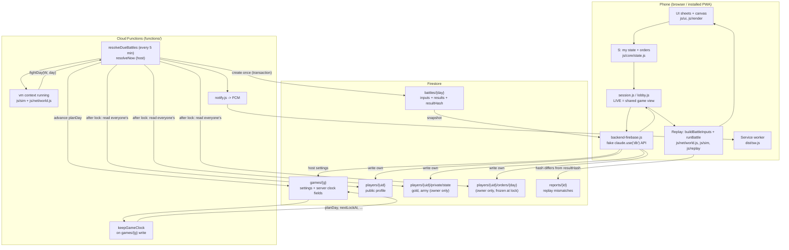

# Architecture

Statements marked **(inferred)** are deduced from the code or history rather than stated in it.

## Overview

Daily Siege has one battle a day per game. The design goal that shapes everything: **orders are
secret until the battle, and every device must show exactly the same fight.**

| Component | Where | Role |
|---|---|---|
| Game client | `index.html`, `js/`, `css/` | Planning UI, canvas map, battle replay. Classic scripts in one global scope |
| Deterministic sim | `js/config/`, `js/core/`, `js/sim/` | `runBattle(plans, seed, opts)`: same inputs -> same result on any JS engine |
| World + clock | `js/net/world.js`, `js/net/clock.js` | Saved game data -> battle inputs (`buildBattleInputs`, `fightDay`); all date rules |
| Backend adapter | `js/net/backend-firebase.js` | Presents Firebase as the legacy `window.claude.use("db"\|"user")` API; splits and re-joins data |
| Security rules | `firestore.rules` | Fog of war: who may read/write what, and when orders freeze |
| Server | `functions/` | Keeps the clock, fights due battles, sends push, host recovery tools |
| Script loader | `functions/lib/game.js`, `tools/load-sim.mjs` | Runs the client's own script files in a Node `vm` context |
| PWA shell | `sw.src.js`, `js/pwa.js`, `manifest.webmanifest` | Offline start, versioned cache, push notifications |
| Build + deploy | `vite.config.js`, `.github/workflows/` | Copy scripts to `dist/`, generate `sw.js`, deploy on merge to `main` |

## Data flow

### A day in the life

1. **Plan.** The player edits `S`; `render()` calls `save()`, which debounces into `writeMine()`
   (`js/net/session.js`). The adapter splits the legacy single player document into the public
   profile, `private/state` and `orders/{planDay}`.
2. **Lock.** `firestore.rules` `ordersOpen()` rejects writes to `orders/{planDay}` once
   `request.time >= nextLockAt`. Tomorrow's orders can already be drafted.
3. **Resolve.** `resolveDueBattles` runs every 5 minutes. `resolveDue` (`functions/lib/resolve.js`)
   reads all orders with the Admin SDK, calls the game's own `fightDay`, then in one transaction
   creates `battles/{day}` (if absent) and advances `planDay`. The transaction makes concurrent
   runs safe.
4. **Replay.** Phones receive the battle document, rebuild the fight from its saved inputs, run the
   same `runBattle`, and compare `battleHash(res)` with the saved `resultHash`. A mismatch is shown
   and written to `reports/`.
5. **Rival view.** A phone never receives rivals' current orders. The adapter rebuilds each rival's
   entry from the public profile plus orders already revealed in finished battles.

### Two modes on one codebase

- **Practice** (`gameMode === "practice"`): bots from `js/core/practice.js`, state in `localStorage`
  (`lastbanner.v4`), battles run locally. Works offline and on PR previews.
- **Friends** (`gameMode === "friends"`): everything above. `isLive()` / `inLobby()` guard the
  differences throughout the UI.

## Key design decisions

| Decision | Trade-off | Source |
|---|---|---|
| **Server fights the battle; clients only replay** | Fixes secret orders (previously every client could read rivals' orders) at the cost of a backend and a strict determinism requirement | `daily-siege-hosting-plan.md` §3.1 |
| **Server runs the client's script files in a `vm`** instead of a port or shared module | One implementation, zero drift; in exchange the game must stay classic scripts with a fixed load order, and `functions/game/` must be synced before deploy | `functions/lib/game.js` header |
| **Own deterministic trig (`detmath.js`)** | `Math.sin` etc. can differ in the last digit between engines; custom versions are slower and less precise but identical everywhere. Drawing code may still use `Math.*` | `README.md`, plan §3.2 |
| **Golden hashes + phone self-test** | 62 recorded battles act as a tripwire for any outcome change; costs ~30 s per test run and a hash re-record on every balance tweak | `test/golden.test.mjs`, `selftest.html` |
| **Adapter fakes the old storage API** rather than rewriting callers | The port touched little game code and the artifact build still runs; the cost is an indirection where client code thinks in `players/{uid}` documents that don't exist in Firestore | `js/net/backend-firebase.js` header |
| **Three-way data split** (public / private / orders-per-day) | Enables rule-level secrecy and per-day freezing; more reads per battle (N+1 per player) | `firestore.rules` header |
| **Clock fields are server-owned and monotonic** | `planDay` only advances when a battle is fought, so changing the battle hour can't skip or repeat a day; requires a trigger function on every settings write | `functions/lib/clock.js` |
| **Seat = id of the account that first registered**; `members/{uid}.seat` can point a new account at it | Lost-phone recovery without rewriting any battle history | `functions/lib/resolve.js` `reassignSeat` |
| **Two regions** | Firestore trigger must sit beside the database (Melbourne); scheduler isn't offered there, so the rest runs in Sydney | `functions/region.js` |
| **No bundling of game scripts** | Vite only serves and copies; keeps `index.html` order authoritative and the `vm` trick possible; no tree-shaking, minification or type checks | `vite.config.js` header |
| **Service worker caches a whole version atomically** | Never a mix of old and new scripts; an update only applies on the next start | `sw.src.js` header |
| **Preview deploys cannot reach game data** | Safe to click around a PR; means multiplayer changes can't be tried on a preview | `findConfig()` in the adapter |
| **Cost caps**: `maxInstances: 2`, one scheduled job, 3-day artifact cleanup | Stays in free tier for ~10 players; would throttle if many games ran at once **(inferred)** | `functions/index.js`, `deploy.yml` |
| **Client-authoritative economy** (gold, army computed on the phone) | Accepted for a friends game; a player can edit their own state | plan §3.3, §7 |

## Weak spots and tech debt (highest risk first)

1. **Sim changes silently rewrite history.** Past battles are replayed from saved inputs with
   current code. The only mechanism is ad-hoc date gates (`ULT_V2_FROM` in `js/sim/battle.js`).
   Forgetting one produces mismatch reports for every past replay in a running war.
2. **Deploy is not gated on the tests that matter most.** `deploy.yml` runs lint, unit and rules
   tests; the e2e, seven-day war and three-browser determinism jobs live in `ci.yml` and run in
   parallel on the same push. A PR merged with red CI still deploys.
3. **Client-authoritative state is trusted by the server.** `loadWorld` reads `private/state` and
   orders as written by the client; rules validate ownership and timing, not content. A crafted
   orders document could field units the player never bought **(inferred from rules; not tested)**.
4. **Global mutable state with no static checking.** ~7,000 lines under `js/` share one scope, are
   exempt from ESLint, and have no types. A typo in a rarely-opened sheet is only found by opening it.
   Only the sim, world and clock have unit tests.
5. **Triplicated lists that must agree:** script order (`index.html`, `selftest.html`,
   `functions/lib/game.js`); server-owned fields (`firestore.rules`, adapter `SERVER_KEYS`,
   `CLOCK_KEYS`); profile keys (`validProfile()` vs what the adapter writes). Only some are tested.
6. **`js/sim/battle.js` is one 820-line function** with lines up to 576 characters. Hard to review,
   and any edit risks an unintended hash change.
7. **Legacy layer leaks.** Player-facing errors reference the old platform ("Ask the host to add
   you as an Editor" in `js/net/session.js`); storage keys are `lastbanner.*`; `index.html` line 1 is
   artifact boilerplate that closes `<head>` early (caused the bug fixed in `7f6099f`).
8. **Tooling drift.** Playwright is required by three test entry points but is not in
   `package.json`. The emulator warns `firebase-functions` ^6 is outdated. `npm ci` reports 22
   audit findings (dev dependencies; not triaged here).
9. **Stale number in the UI:** `selftest.html` says 50 battles; there are 62 (`README.md` was corrected).
10. **Single-game UI on a multi-game data model**, and `resolveAllDue` processes games sequentially
    inside one 120 s invocation. Fine for one group; a limit if it grows **(inferred)**.

## Long-term direction and recommendations

Ordered so that each step makes the next one safer. Items 1 and 5 restate `README.md` "Next steps";
the rest are recommendations from this review.

1. **Version the ruleset explicitly.** Store a `rules` version in each `battles/{day}` document and
   have `runBattle` branch on it, replacing date gates. This makes weak spot 1 a checked invariant:
   a golden test per version.
2. **Gate deploys on the full CI.** Make `deploy.yml` depend on the `browsers` and `firebase` jobs
   (or trigger it from a successful CI run), so `main` can't ship a determinism regression.
3. **Single source of truth for shared lists.** Generate the `<script>` blocks of `index.html` and
   `selftest.html` and the rules' field lists from one manifest, or at minimum add unit tests that
   compare them (as already done for `SIM_FILES` and the function region).
4. **Lint the game scripts in a low-noise mode.** Turn on `no-undef` / `no-unused-vars` for `js/**`
   with a generated globals list before any module conversion. Cheap, and catches typo-class bugs.
5. **Move to ES modules from the inside out** (`config/` -> `core/` -> `sim/` -> `net/world.js`), with one
   owner module for `S`, `DAY`, `mode`, `replay`, `LIVE`. The `vm` loader then becomes a plain
   `import` in Functions and `functions/game/` syncing disappears. Do this *after* 1-4 so the golden
   tests and lint catch regressions; split `battle.js` as part of it.
6. **Validate orders on the server.** Before `fightDay`, check each plan against `private/state`
   (owned units, gold spent). Full server-side economy is a larger step and only worth it if the
   audience grows beyond trusted friends.
7. **Retire the artifact compatibility layer** once the Claude-hosted version is frozen (plan §7 says
   it should be): call Firestore directly from `session.js`, drop the fake `players/{uid}` join, and
   rename storage keys with a migration.
